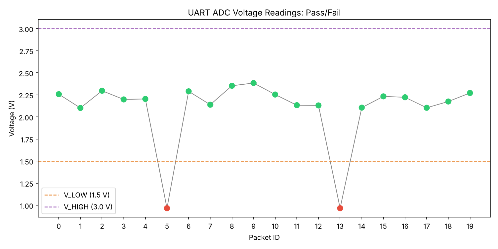

# UART Test

Simulates a device sending ADC readings over a serial (UART) link and an automated host-side test that receives, checks, and logs them.

A C program plays the device firmware. A Python script plays the test station. They talk over a pair of virtual serial ports, so no hardware is needed.



## How it works

```
device_sim (C)  -->  /tmp/ttyV0 ==socat== /tmp/ttyV1  -->  host_logger.py (Python)
```

1. `socat` creates two linked virtual serial ports. Bytes written to one come out of the other.
2. `device_sim.c` sends 20 packets, 100 ms apart, in this format:
   ```
   PKT:05,ADC:1200,VOLT:0.9670
   ```
   Normal readings are about 2.25 V with a little random noise. Packets 5 and 13 are forced to a low reading (ADC 1200, 0.967 V) to inject known faults.
3. `host_logger.py` reads each line with pyserial, parses it, and marks it PASS if the voltage is between 1.5 V and 3.0 V. It skips malformed lines, checks for missing packet IDs, prints a summary, and writes `results.csv`.
4. `plot_results.py` plots the readings with passing packets in green and failures in red.

A correct run reports exactly 2 failures, at packets 5 and 13.

## Files

- `device_sim.c`: device simulator (C)
- `host_logger.py`: host test and logger (Python)
- `plot_results.py`: plots `results.csv` to `voltage_plot.png`
- `limits.py`: pass/fail limits used by both Python scripts
- `run_test.sh`: runs the whole test
- `results.csv`, `voltage_plot.png`: output from a sample run

## Setup

Needs `gcc`, `socat`, and Python 3.

```
# macOS
brew install socat

# Ubuntu / Debian
sudo apt install socat
```

```
python3 -m venv venv
source venv/bin/activate
pip install -r requirements.txt
```

## Usage

```
./run_test.sh
```

The script compiles `device_sim.c` if needed, starts `socat`, runs the logger and simulator, then makes the plot. It uses `venv/` if it exists.

To change the limits, edit `limits.py`.

## Example output

```
PKT 00 | ADC 2802 | 2.2580 V | PASS
PKT 01 | ADC 2608 | 2.1017 V | PASS
...
PKT 05 | ADC 1200 | 0.9670 V | FAIL
...
PKT 13 | ADC 1200 | 0.9670 V | FAIL
...

--- Summary ---
Limits        : 1.5 to 3.0 V
Total packets : 20
Pass          : 18
Fail          : 2
Malformed     : 0
Missing IDs   : none
Min voltage   : 0.9670 V
Max voltage   : 2.3845 V
Mean voltage  : 2.0895 V
Std dev       : 0.3825 V
```

## Notes

- The baud rate in `host_logger.py` is required by pyserial but has no effect on virtual ports. On real hardware it must match the device.
- The logger stops after 3 seconds with no new data.
